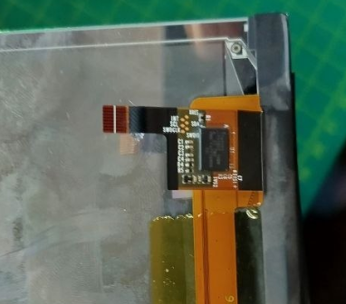
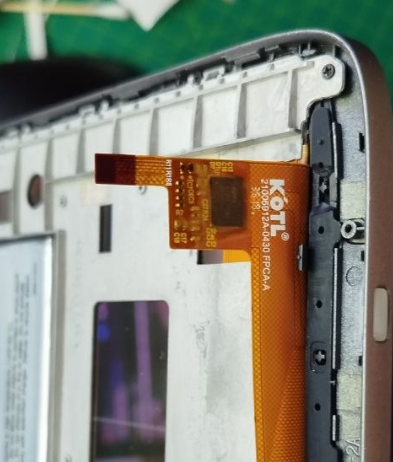
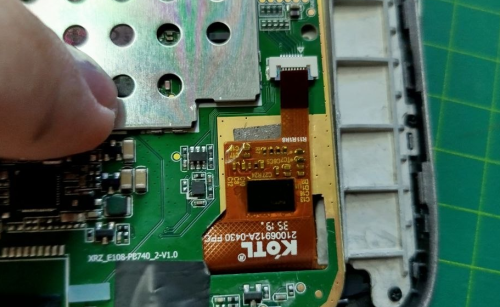

# Elankc1

Драйвер тача Elan для PocketBook 740 (InkPad 3) и 740 Pro (InkPad 3 Pro), если вместо родного экрана стоит ED078KC1.

Готовые модули `.ko` и скрипты лежат в [Releases](https://github.com/moss-maurice/elankc1/releases).

> [!CAUTION]
>
> Плату придётся пилить, а систему вскрывать через jailbreak. Гарантия на этом кончается. Книгу легко убить: сорвать дорожку, устроить короткое замыкание, получить кирпич. Делаете вы это сами и на свой страх. Автор ответственности не несёт. Если сомневаетесь — лучше не начинать.

> [!WARNING]
>
> Без выпила в материнской плате экран KC1 не запустится. Шлейф тача просто не доходит до разъёма. Драйвер и jailbreak тут бессильны, это вопрос железа. Как пилить — ниже. Исходное описание: [сообщение на 4PDA](https://4pda.to/forum/index.php?showtopic=886480&view=findpost&p=144920298).

> [!IMPORTANT]
>
> Обновление прошивки стирает патч. Тач KC1 снова молчит, а поставить драйвер заново почти не получится: без тача в меню не зайти, а jailbreak запускается оттуда. Родную панель с живым тачем лучше не выбрасывать. Самый спокойный вариант — прошивку не обновлять.
>
> Проверено на 740 Pro, прошивка **U740-2.5.20.1154**. На обычном 740 шаги те же. Линейки не путать: на 740 ставится только `U740`, на Pro — только `U740-2`. Чужой `SWUPDATE.BIN` ставить нельзя, обновление может зациклиться.

## Зачем это нужно

С завода у обеих книг экран ED078KH4 и тач Cypress. Прошивка умеет только его.

KC1 ставят на замену, потому что картинка лучше. Тач там другой — Elan, и штатный драйвер Cypress этот чип не узнаёт. Книга либо зависает на логотипе, либо доходит до стола, а нажатия не работают.

Этот проект ставит свой драйвер. При загрузке книга смотрит, какой чип сидит на шлейфе: Elan — поднимается наш модуль, Cypress — остаётся штатный. Для остальной прошивки тач выглядит родным, InkView работает как обычно.

## Доработка платы

Это самая рискованная часть. Если с платами раньше не работали, выпил лучше отдать тому, кто гравирует и паяет.

Шлейфы KC1 и KH4 почти совместимы. Мешает одна вещь: у KC1 шлейф тача намного шире. Он упирается в край платы и до разъёма не достаёт. У KH4 шлейф идёт прямо, у KC1 сначала уходит влево, потом вдоль стекла к центру. Обрезать его нельзя, компактно сложить тоже не выходит.

Остаётся выпилить кусок платы рядом с разъёмом тача. С обеих сторон в этом месте земля, плата двусторонняя. Соседние дорожки не задевать. Хватит гравера и надфилей. После выпила шлейф KC1 нормально садится в разъём.

<details>
<summary>Как пилить плату и фото</summary>

Шлейф тача KH4:



Шлейф тача KC1:



Где они расходятся:


Выпил в плате:


Так выглядит готовый выпил:


Шлейф тача KC1 в разъёме:



</details>

## Установка

На 740 и 740 Pro всё одинаково. Сначала нужен jailbreak: без него нет SSH, и модули тача подменить нечем.

1. Скачайте **[pbjb](https://github.com/ezdiy/pbjb)** v8: [готовые файлы](https://github.com/ezdiy/pbjb/releases). На книге поставьте USB в режим **«Связь с ПК»** и скопируйте оба файла `.app` в папку `applications`. Запустите **`@Jailbreak`**, дождитесь, пока он закончит, затем **`@Services`**, и перезагрузите книгу. Повторный запуск снимает то, что поставили.

2. В настройках появится **Rooted Device Settings**. Там будет пароль пользователя `root`. Его можно сменить.

3. Переключите USB в режим **«Зарядка»**. С компьютера, из PowerShell от администратора, проверьте, что книга отвечает:

   ```text
   ssh -o HostKeyAlgorithms=+ssh-rsa -o PubkeyAcceptedKeyTypes=+ssh-rsa root@169.254.0.1
   ```

   Логин `root`, пароль — из Rooted Device Settings. Если адрес `169.254.0.1` молчит, откройте Rooted Device Settings → System Status и возьмите IP книги в Wi‑Fi.

4. Если KC1 уже воткнут и книга висит на логотипе, выньте шлейф тача, зажмите питание примерно на 30 секунд и дождитесь стола.

5. Распакуйте zip из [Releases](https://github.com/moss-maurice/elankc1/releases). Если собирали сами — берите папку `build/`. Скрипты и файлы `.ko` должны лежать в одной папке.

   ```powershell
   powershell -ExecutionPolicy Bypass -File .\install_elankc1.ps1
   ```

6. Пароль SSH спросит дважды: сначала при копировании файлов, потом когда скрипт ставит модули на книге. Дождитесь строки `[ok]  setup complete`. Книга сама не перезагрузится.

7. Выключите книгу, вставьте шлейф тача KC1 и включите.

## Файлы

У каждого действия есть скрипт для PowerShell и такой же для оболочки. С Windows удобнее `.ps1`: он сам заходит на книгу по SSH.

- [**`install_elankc1.ps1`**](scripts/install_elankc1.ps1) / [**`install_elankc1.sh`**](scripts/install_elankc1.sh) — ставят драйвер Elan и модуль, который при загрузке понимает, какой чип на шлейфе
- [**`uninstall_elankc1.ps1`**](scripts/uninstall_elankc1.ps1) / [**`uninstall_elankc1.sh`**](scripts/uninstall_elankc1.sh) — убирают Elan и возвращают штатный Cypress. Перед перезагрузкой выньте шлейф KC1
- [**`restore_factory.ps1`**](scripts/restore_factory.ps1) / [**`restore_factory.sh`**](scripts/restore_factory.sh) — то же самое, если на книге остались файлы от старых версий (`.bak`, `.stock`, `elan_kc1.ko`). Шлейф KC1 выньте
- [**`disable_cyttsp5.ps1`**](scripts/disable_cyttsp5.ps1) / [**`disable_cyttsp5.sh`**](scripts/disable_cyttsp5.sh) — прячут штатный Cypress с пути `cyttsp5.ko`. Драйвер Elan при этом не ставится: книга перестаёт виснуть на логотипе, но тач не заработает
- [**`enable_cyttsp5.ps1`**](scripts/enable_cyttsp5.ps1) / [**`enable_cyttsp5.sh`**](scripts/enable_cyttsp5.sh) — возвращают штатный Cypress на место. Шлейф KC1 выньте
- **`elankc1.ko`** / **`tpselect.ko`** — сами модули. В zip релиза они лежат рядом со скриптами

## Откат

Сначала выньте шлейф KC1. Иначе после отката книга снова зависнет на логотипе.

```powershell
powershell -ExecutionPolicy Bypass -File .\uninstall_elankc1.ps1
```

Если остались старые имена файлов (`.bak`, `.stock`, `elan_kc1.ko`):

```powershell
powershell -ExecutionPolicy Bypass -File .\restore_factory.ps1
```

Когда всё-таки нужно обновить прошивку, сначала верните родную панель с живым тачем и снимите jailbreak (ещё раз запустите `@Jailbreak` и `@Services`). Ставьте только свою линейку: на 740 — `U740`, на Pro — `U740-2`. Чужая прошивка может зациклить обновление, а без рабочего тача патч заново не поставить.

## Частые проблемы

### Книга зависла на логотипе

Выньте шлейф тача KC1, зажмите питание примерно на 30 секунд и дождитесь стола. После этого ставьте драйвер, как написано выше.

### `[fail] no reply from 169.254.0.1`

Книга не отвечает по кабелю. USB должен быть в режиме **«Зарядка»**, jailbreak и `@Services` — установлены. Если по USB тихо, зайдите по Wi‑Fi: адрес есть в Rooted Device Settings → System Status.

### Рядом со скриптом нет `.ko`

В папке `scripts/` модулей нет, оттуда ставить нечего. Возьмите zip со [страницы Releases](https://github.com/moss-maurice/elankc1/releases) или соберите проект сами — готовое окажется в `build/`.

## Сборка

Собирать можно только на Linux. Нужно дерево ядра [pocketbook/kernel-b288](https://github.com/pocketbook/kernel-b288): конфиг `740-2_defconfig`, подготовка модулей (`modules_prepare`) и кросс-компилятор `arm-linux-gnueabi-`. Версия ядра — **`3.10.65+`**.

```sh
make KERNELDIR=/tmp/kernel-b288
```

Папка `build/` появится сама. В ней будут `.ko`, скрипты и инструкция. Ставить надо из неё, так же как из zip релиза.

Ядро 3.10 на gcc 13 само не собирается. Перед подготовкой ядра положите заглушку `compiler-gcc13.h` — это копия `compiler-gcc5.h` — и соберите с `HOSTCFLAGS=-fcommon`.

## Лицензия

[GPL-2.0](LICENSE)
