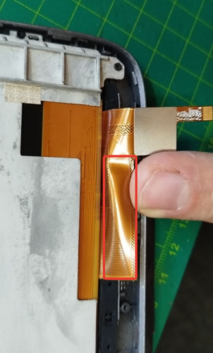
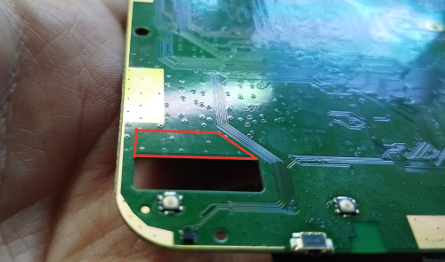
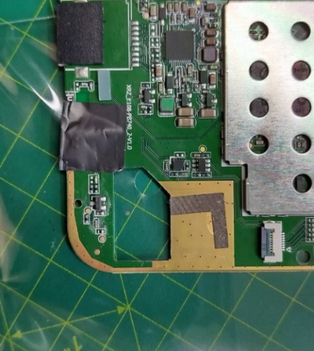

# Elankc1

Тач Elan для **PocketBook 740** (InkPad 3) и **740 Pro** (InkPad 3 Pro) с экраном **ED078KC1** (KC1).

Готовые `.ko` и скрипты — в [Releases](https://github.com/moss-maurice/elankc1/releases).

> [!CAUTION]
>
> ### ОТКАЗ ОТ ОТВЕТСТВЕННОСТИ
>
> ВСЕ МОДИФИКАЦИИ ПРОГРАММНОЙ ЧАСТИ И МАТЕРИНСКОЙ ПЛАТЫ ПРОИЗВОДЯТСЯ НА СВОЙ СТРАХ И РИСК, ЭТО НЕМИНУЕМО ПРИВЕДЕТ К СЛЕТАНИЮ ГАРАНТИИ, УНИЧТОЖЕНИЮ УСТРОЙСТВА, ЗАХВАТУ ПЛАНЕТЫ ИНОПЛАНЕТНЫМИ ЦИВИЛИЗАЦИЯМИ И ЛУЧШЕ 100 РАЗ ПОДУМАТЬ ПЕРЕД ТЕМ, КАК ЧТО-ТО ДЕЛАТЬ. АВТОР СНИМАЕТ С СЕБЯ ЛЮБУЮ ОТВЕТСТВЕННОСТЬ, А ЛЮБЫЕ МОДИФИКАЦИИ ВЫ ПРОВОДИТЕ НА СВОЙ СТРАХ И РИСК.

> [!WARNING]
>
> ### ДОРАБОТКА ПЛАТЫ ОБЯЗАТЕЛЬНА
>
> Без выпила в материнской плате экран KC1 **не запустить**. Шлейф тача физически не садится в разъём — драйвер и jailbreak тут ни при чём.
>
> Пилить плату — на свой страх и риск. Автор ответственности не несёт: ни за сорванные дорожки, ни за короткое замыкание, ни за «кирпич».
>
> Исходное описание: [сообщение на 4PDA](https://4pda.to/forum/index.php?showtopic=886480&view=findpost&p=144920298).

> [!IMPORTANT]
>
> После обновления прошивки патч **слетает**. Тач KC1 снова не работает, а накатить драйвер без живого тача почти нельзя: снова нужен jailbreak, а в меню без тача не попасть.
>
> Сохраните родную панель, если тач на ней ещё живой, либо **не обновляйте прошивку**.
>
> Проверено на 740 Pro, **U740-2.5.20.1154**. На обычном 740 шаги те же. Прошивки не мешать: на 740 только `U740`, на Pro только `U740-2`. Чужой `SWUPDATE.BIN` ставить нельзя.

## Зачем это нужно

У обеих книг родной экран — ED078KH4 (KH4), тач Cypress. Прошивка умеет только его.

Экран KC1 часто ставят вместо родного: картинка лучше, но тач там **Elan**. Штатный драйвер Cypress этого чипа не знает. Книга либо зависает на логотипе, либо загружается без тача.

Этот проект ставит свой драйвер Elan. При загрузке книга смотрит, какой чип на шлейфе: Elan — свой драйвер, Cypress — штатный. Для прошивки тач выглядит как родной, InkView работает как обычно.

## 🪚 Доработка платы

<details>
<summary>Как пилить плату и фото</summary>

> [!IMPORTANT]
>
> ### Доработка материнской платы
>
> **Без выпила в плате экран KC1 не запустить.** Шлейф тача физически не садится в разъём — драйвер и jailbreak тут ни при чём.
>
> Пилить плату — **на свой страх и риск**. Автор ответственности не несёт: ни за сорванные дорожки, ни за короткое замыкание, ни за «кирпич». Исходное описание: [сообщение на 4PDA](https://4pda.to/forum/index.php?showtopic=886480&view=findpost&p=144920298).
>
> По шлейфам KC1 и KH4 почти совместимы. Отличие одно: у KC1 шлейф тача намного шире. Он упирается в край платы и не дотягивается до разъёма. У KH4 шлейф идёт прямо, у KC1 — сначала влево, потом вдоль стекла к центру. Обрезать его нельзя, сложить компактно тоже не получается.
>
> Выход: выпилить кусок платы рядом с разъёмом тача. С обеих сторон там земля, плата двусторонняя — соседние дорожки не задевать. Подойдут гравер и надфили. После выпила шлейф KC1 уверенно входит в разъём.
>
> Шлейф тача KH4:
>
> 
>
> Шлейф тача KC1:
>
> 
>
> Где они расходятся:
>
> 
>
> Выпил в плате:
>
> 
>
> Так выглядит готовый выпил:
>
> 
>
> Шлейф тача KC1 в разъёме:
>
> 

</details>

## ⚙️ Установка

Одинаково для 740 и 740 Pro. Без jailbreak нет SSH и нельзя подменить модули тача.

1. Скачайте **[pbjb](https://github.com/ezdiy/pbjb)** v8: [готовые файлы](https://github.com/ezdiy/pbjb/releases). USB = **«Связь с ПК»**, два `.app` в папку `applications`. Запустите **`@Jailbreak`**, дождитесь успеха, затем **`@Services`**, перезагрузите книгу. Повторный запуск снимает соответствующую часть.

2. В настройках появится **Rooted Device Settings** — там сгенерированный пароль `root`, его можно сменить.

3. USB переключите на **«Зарядка»**, не «Связь с ПК». С компьютера (PowerShell от администратора):

   ```text
   ssh -o HostKeyAlgorithms=+ssh-rsa -o PubkeyAcceptedKeyTypes=+ssh-rsa root@169.254.0.1
   ```

   Логин `root`, пароль — из Rooted Device Settings. Если `169.254.0.1` молчит, IP по Wi‑Fi смотрите в Rooted Device Settings → System Status.

4. Если книга уже зависла на логотипе с воткнутым KC1 — выньте шлейф, зажмите питание ~30 с, дождитесь стола.

5. Распакуйте zip из [Releases](https://github.com/moss-maurice/elankc1/releases) (или возьмите `build/` после сборки). Скрипты и `.ko` должны лежать в одной папке.

   ```powershell
   powershell -ExecutionPolicy Bypass -File .\install_elankc1.ps1
   ```

6. Пароль SSH спрашивается дважды. Дождитесь `[ok]  setup complete`. Книга **сама не перезагрузится**.

7. **Выключите книгу**, вставьте шлейф тача KC1, включите.

## ℹ️ Файлы

- [**`install_elankc1.ps1`**](scripts/install_elankc1.ps1) / [**`install_elankc1.sh`**](scripts/install_elankc1.sh) — поставить зонд и драйвер Elan
- [**`uninstall_elankc1.ps1`**](scripts/uninstall_elankc1.ps1) / [**`uninstall_elankc1.sh`**](scripts/uninstall_elankc1.sh) — вернуть штатный Cypress, убрать Elan. **Шлейф KC1 вынуть**
- [**`restore_factory.ps1`**](scripts/restore_factory.ps1) / [**`restore_factory.sh`**](scripts/restore_factory.sh) — заводской тач, если остались старые имена файлов. **Шлейф KC1 вынуть**
- [**`disable_cyttsp5.ps1`**](scripts/disable_cyttsp5.ps1) / [**`disable_cyttsp5.sh`**](scripts/disable_cyttsp5.sh) — спрятать стоковый Cypress с пути `cyttsp5.ko` (без установки Elan)
- [**`enable_cyttsp5.ps1`**](scripts/enable_cyttsp5.ps1) / [**`enable_cyttsp5.sh`**](scripts/enable_cyttsp5.sh) — вернуть сток на место зонда. **Шлейф KC1 вынуть**
- **`elankc1.ko`** / **`tpselect.ko`** — модули, в zip релиза лежат рядом со скриптами

## ↩️ Откат

Шлейф KC1 **вынуть**, иначе книга снова зависнет на логотипе.

```powershell
powershell -ExecutionPolicy Bypass -File .\uninstall_elankc1.ps1
```

Старые имена файлов (`.bak`, `.stock`, `elan_kc1.ko`):

```powershell
powershell -ExecutionPolicy Bypass -File .\restore_factory.ps1
```

Если всё же обновляете ПО: сначала верните родную панель с живым тачем, снимите jailbreak (`@Jailbreak` / `@Services`) и ставьте только свою линейку — на 740 `U740`, на Pro `U740-2`. Иначе апдейт может зациклиться, а без тача патч заново не накатить.

## ☑️ Частые проблемы

### Книга зависла на логотипе

Выньте шлейф тача KC1, зажмите питание примерно на 30 секунд, дождитесь стола. Потом ставьте драйвер, как выше.

### `[fail] no reply from 169.254.0.1`

USB = **«Зарядка»**, не «Связь с ПК». Jailbreak и `@Services` должны быть установлены. Иначе смотрите Wi‑Fi IP в Rooted Device Settings → System Status.

### Нет `.ko` рядом со скриптом

Берите zip со [страницы Releases](https://github.com/moss-maurice/elankc1/releases) или собирайте сами (ниже). Из `scripts/` без модулей ставить нечего.

## 🛠️ Сборка

Только на Linux. Нужно дерево ядра [pocketbook/kernel-b288](https://github.com/pocketbook/kernel-b288): конфиг `740-2_defconfig`, `modules_prepare`, кросс-компилятор `arm-linux-gnueabi-`. Версия ядра — **`3.10.65+`**.

```sh
make KERNELDIR=/tmp/kernel-b288
```

Каталог `build/` создаётся сам. Туда попадают `.ko`, скрипты и `README`. Дальше ставьте из `build/`, как из релиза.

На gcc 13 для подготовки ядра 3.10 нужны заглушка `compiler-gcc13.h` (копия `compiler-gcc5.h`) и `HOSTCFLAGS=-fcommon`.

## ⚖️ Лицензия

[GPL-2.0](LICENSE)
